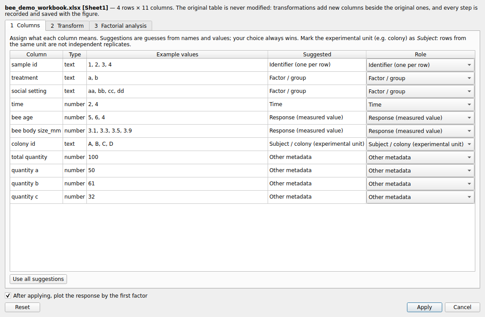
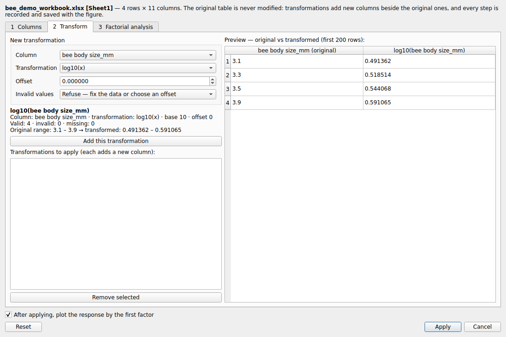
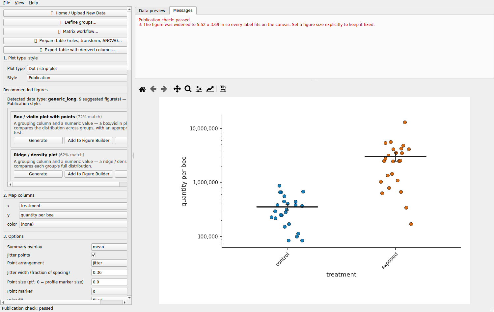
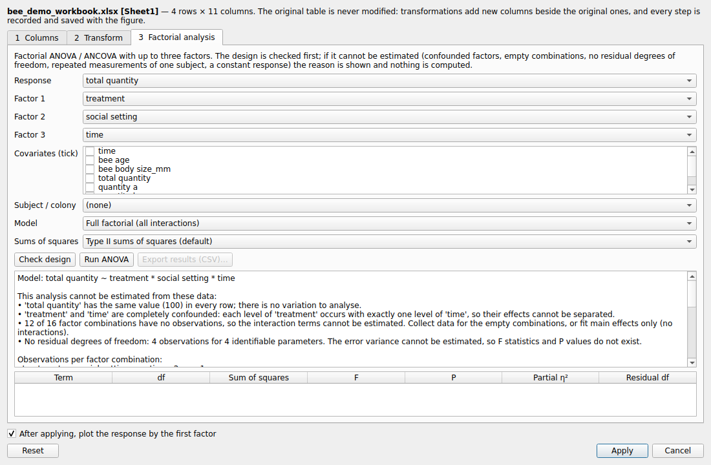

## Part XXVIII — Ordinary experimental tables, log axes and factorial ANOVA

### 76. Experimental tables are not matrices

A table with one row per observation (treatment, time, colony, body size, a measured
quantity) is handled as an ordinary table. Make My Figure recognises it by its factor
columns, whose few levels repeat down the rows, and by numeric columns that include
coded factors or constants. It recommends group comparison plots, not heatmaps or
PCA. Click **📋 Prepare table (roles, transform, ANOVA)…** (browser: the
**📋 Prepare table** expander).

### 77. Column roles

Assign each column a role: identifier, response, factor/group, time, covariate,
subject/colony (the experimental unit), label, other metadata, or ignore. Suggestions
show their reason; your choice always wins. Rows that share a subject are not
independent replicates.

### 78. Transformations with a preview

log10, log2, ln, square root and z-score each **add a new column** (`log10(x)`) beside
the original. The original table never changes. The offset is explicit and defaults
to 0. Values a transformation is undefined for (0 and negatives for a log) are counted
in the preview and refused, unless you choose to record them as missing in the new
column. The preview shows original and transformed values with valid / invalid /
missing counts and both ranges. Apply, Cancel, Reset; **↩ Revert to original data**
in the editor.

**Export table with derived columns…** writes the transformed values (CSV / TSV /
XLSX) plus a JSON record of how each column was made. A Figure Package stores the raw
table, the derived table and the record, and replays the record when it is reopened.

### 79. Log axes and tick notation (display only)

Under **5. Publication style ▸ Axis scale & range**: Linear / Log10 / Log2 / Natural
log; tick labels Plain (1, 10, 1,000), Powers (10⁰, 10¹) or Scientific (×10ⁿ on a
linear axis); minor ticks; minimum and maximum. The axis changes, the values do not:
statistics and exports keep the original numbers. Offered on bar, grouped bar,
scatter, box/violin, line, dot/strip and paired plots. A log axis is refused, with a
message, for values ≤ 0, for a column that already holds log values, or for a range
that would hide data.

A log-transformed column and a log axis are different analyses. A mean on a log axis
is the arithmetic mean; the mean of log values is the log of the geometric mean.

### 80. Factorial ANOVA and non-estimable designs

**3 Factorial analysis**: a response, up to three factors, optional covariates and a
subject column; full factorial or main effects; Type II (default) or Type III
(sum-to-zero contrasts) sums of squares; partial η² for each term. The design is
checked first. Complete confounding, empty factor combinations, no residual degrees
of freedom, a constant response, or repeated rows from one subject are explained,
and nothing is computed. Validated against base R (509 of 509 quantities agree).
The **Coefficients** tab gives R's `summary(lm)` under sum-to-zero coding (estimate,
SE, t, P, 95 % CI) with readable names; each table has its own CSV export.

See `docs/GENERAL_TABULAR_DATA.md`, `docs/AXIS_SCALING.md`, `docs/STATISTICS_FACTORIAL.md`
and the step-by-step tutorial in `tutorial/general_tabular_data/`.

### 81. Facet grids: one panel per factor combination

On the box/violin plot and the line/time-course plot, map **facet_row** and/or
**facet_col** to split the figure into a grid of panels, one per level of each
column: a 2 species × 2 ages × 3 nitrogen × 4 months design reads as
`facet_row = Age`, `facet_col = Species`, `x = Month`, `hue` (or `color`) =
nitrogen. Every panel keeps the same category order, the same colour per level and
one shared value axis (**Facets share the value axis** turns the last off and labels
every panel); strip labels read `Species: Species_A` (or the value alone with
**Facet labels**); only the outer panels carry tick labels. The title, axis labels and
legend are shared, so the legend, axis, palette, colour-override and typography
controls act on the whole grid; a legend below or above the grid is laid out in one
row. Statistics run within each panel; **Also test across the whole grid** in the
statistics panel fits one ANOVA with the facet variables as factors
(`Growth ~ Month × Age × Species`). The line plot's **Error display** draws mean ± SE
as bars instead of a band. Tutorial step 11 and `docs/GROUP_COMPARISON_PLOTS.md`
give the details.

### 82. Wide tables: reshape to long form

A wide table (one row per plant, one column per sampling month: `Month_4 … Month_10`)
is reshaped with **↕ Wide → long…** beside *Prepare table* (browser: the **↕ Wide →
long** expander). When columns share a name with a number after it the button reads
*(suggested)* and opens with them ticked, the prefix removed and the months as numbers;
every other column (Species, Age, Nitrogen, Replicate) is repeated on each row, so
60 wide rows become 240 long ones. Problems — a new column named like an existing one,
gathered columns mixing numbers and text — are shown before anything is applied. The
wide file is never changed: the long table is saved beside it as `<name>_long.csv`
with its record, **Revert to original data** goes back, and a Figure Package keeps
both tables and replays the reshape. Details: `docs/GENERAL_TABULAR_DATA.md`.

### 83. Assumption checks before a parametric test

Before a t-test, ANOVA or Pearson correlation runs, its assumptions are tested and the
results listed in the statistics table (verdict **met**, **NOT met** in red, or *not
tested*), in the method sentence and as a warning when one fails:
**Shapiro-Wilk** for normality (each group for a t-test, the paired differences for a
paired t-test, the **model residuals** for an ANOVA) and **Levene's test**
(median-centred) for equal variances where the test assumes them. **If assumptions
fail** in the Statistics panel decides what happens: keep the chosen test and report
it (default), or use the non-parametric alternative (Mann-Whitney, Wilcoxon,
Kruskal-Wallis with Dunn, Spearman; Welch's t when only Student's equal variances
fail). A two-way or factorial ANOVA is never replaced: the warning recommends a log or
square-root transformation instead. On a facet grid every panel is checked.

### 84. Residual plots (model diagnostics)

**Model diagnostics (residual plots)…** in the Statistics panel draws R's four
`plot(lm)` panels for the model behind the test: Residuals vs Fitted, Normal Q-Q,
Scale-Location (a rising line means the variance grows with the mean) and Residuals vs
Leverage with Cook's distance (for a balanced design, residuals by factor level, as in
R). The three most extreme rows are numbered. Choose a facet **Panel** or the whole
grid, and another **Response** - a transformed column from *Prepare table* - to see
whether a transformation helps. Save the figure (PNG, PDF, SVG) or the values (CSV).
In the browser: the 🔍 Model diagnostics expander, *Draw the residual plots*.

### 85. Statistics report in R's format

**Statistics report (R-style summary(aov), TukeyHSD)…** prints the model's ANOVA table
and Tukey HSD comparisons exactly as R's console prints `summary(aov(...))` and
`TukeyHSD(...)`, followed by the assumption checks and the software versions. Copy it
or save it as a text file for a lab notebook or a supplement. The table uses Type I
(sequential) sums of squares, as R does; with equal group sizes this equals the
figure's ANOVA, and with unequal sizes the report says how they differ.

