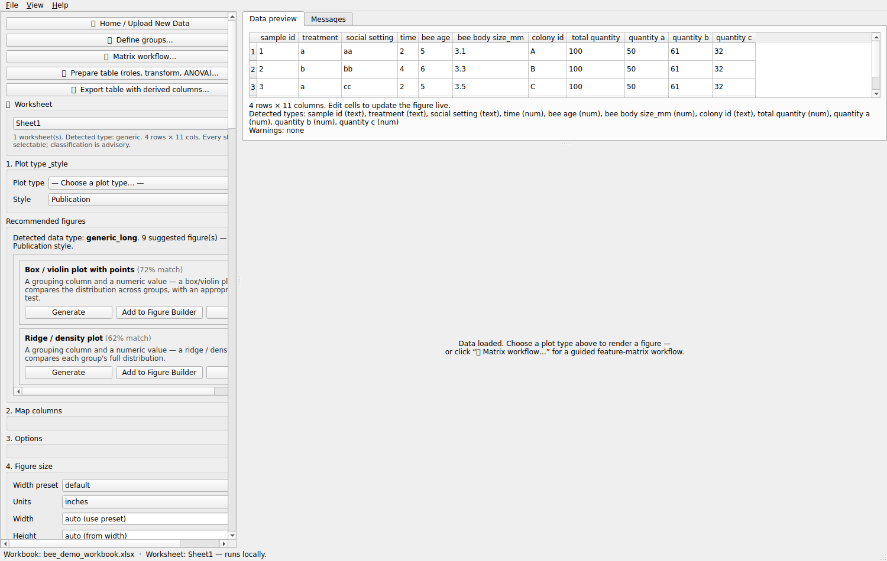
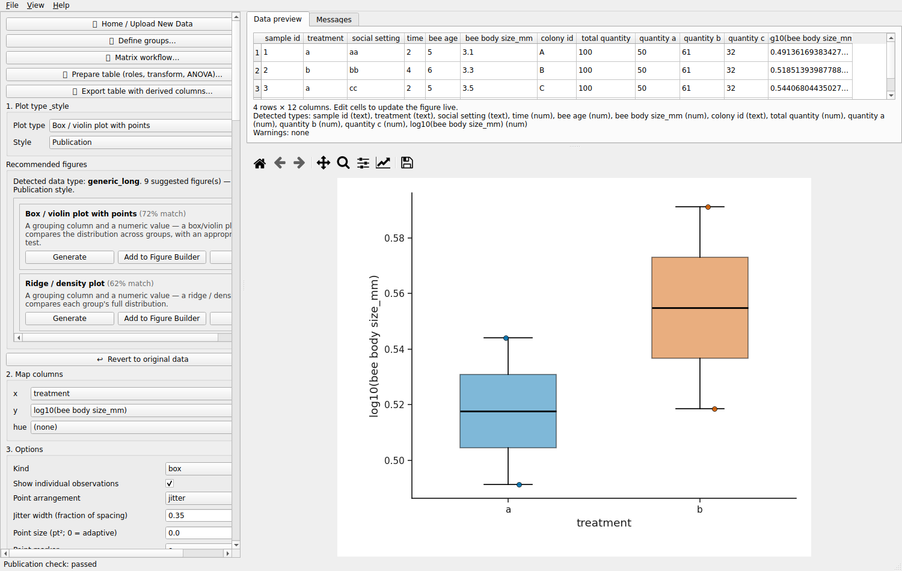
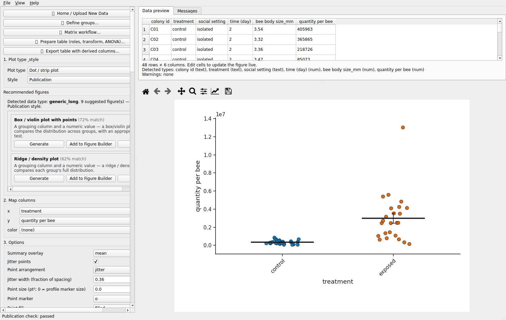
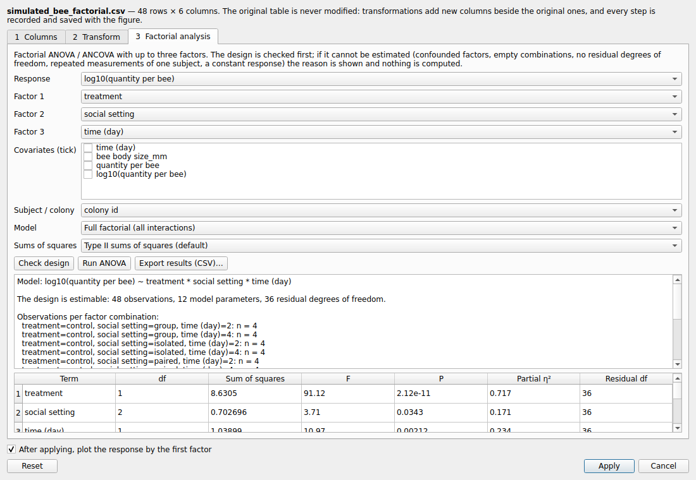
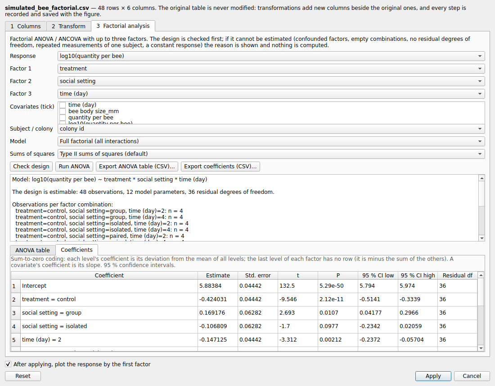
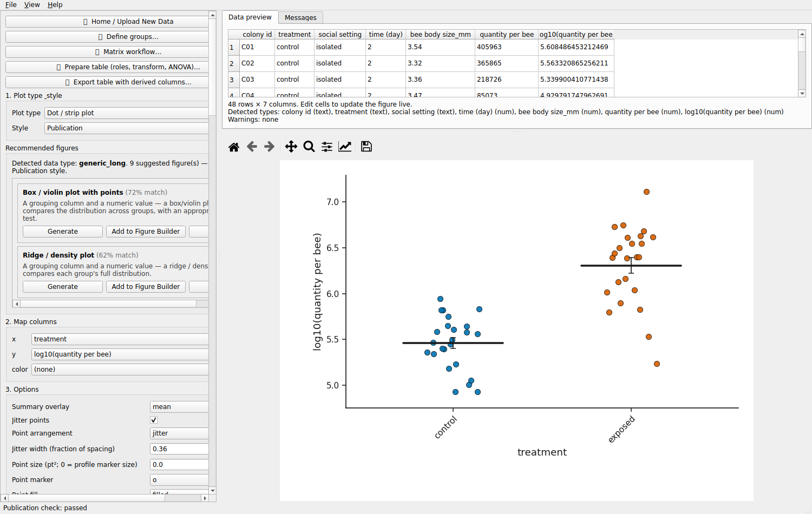
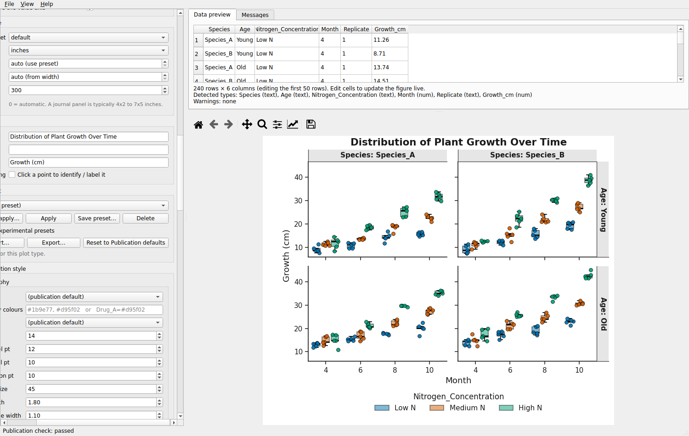
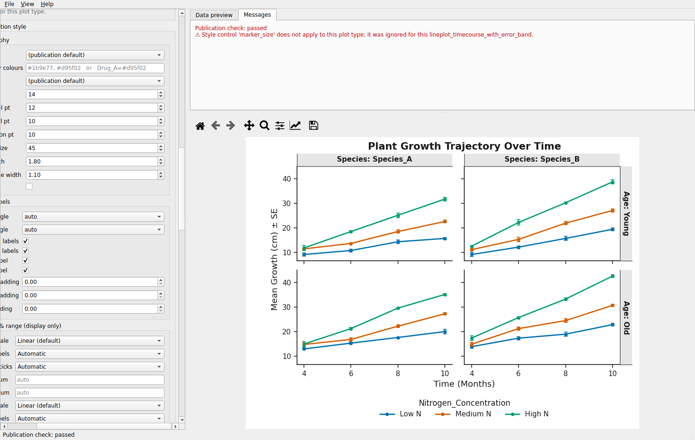

# Tutorial — an ordinary experimental table (ecology / entomology)

You will import a small bee workbook, say what each column means, log-transform a
measurement, plot raw values on a log axis, learn the difference between the two,
see why a three-way ANOVA cannot be run on four rows, run one on a properly
replicated (simulated) design, and save, export and reopen the result.

Data used:

| File | What it is |
|---|---|
| `tests/fixtures/bee_demo_workbook.xlsx` | The 4-row workbook supplied by a user (`sample id`, `treatment`, `social setting`, `time`, `bee age`, `bee body size_mm`, `colony id`, `total quantity`, `quantity a/b/c`). |
| `data/simulated_bee_factorial.csv` | **Simulated**, from `data/make_simulated_data.py` (fixed seed): 2 treatments × 3 social settings × 2 days × 4 colonies, one bee per colony. Shaped like an insect experiment; **not** real observations; never report it as biology. |

Screenshots were captured from the real desktop application by
`make_screenshots.py` on Linux, where emoji on the buttons render as boxes. On
macOS and Windows they show their icons.

---

## 1. Import the workbook

**File ▸ Open data file…** and choose the workbook. The worksheet selector lists
every sheet; this workbook has one. The app recognises the sheet as an experimental
table (one row per observation, with factor columns), not as a feature matrix, so
it suggests box, bar and scatter plots rather than a heatmap.

## 2. Say what each column is

Click **📋 Prepare table (roles, transform, ANOVA)…**. On **1 Columns**, each
column has a suggested role and the reason for it. Change any of them; your choice
always wins.

* `treatment`, `social setting` are factors; `time` (2 and 4) is better used as a
  factor than as a number.
* `colony id` is the **experimental unit**. Rows from the same colony would not be
  independent replicates.
* `total quantity` and `quantity a/b/c` are the same in every row (100, 50, 61, 32),
  so they are suggested as metadata: there is nothing to analyse. (Also note that
  a + b + c = 143, while `total quantity` = 100. Worth checking with whoever
  recorded the data.)

## 3. Log-transform a measurement, with a preview

On **2 Transform**, pick `bee body size_mm` and **log10(x)**. The preview shows
original and transformed values side by side, and above them the method, base,
offset, how many values are valid / invalid / missing, and the range before and
after.

* The **offset is 0** unless you change it. No `+ 1` is added behind your back.
  An offset you choose appears in the new column's name, `log10(count + 1)`.
* If a value were 0 or negative, the count of invalid values would show here and
  **Add** would stay disabled. You then either choose an offset you can justify, or
  explicitly **record those observations as missing** in the new column; the
  originals are always kept.
* **Add this transformation**, then **Apply**. The table gains a column
  `log10(bee body size_mm)`. The original column, and the original table, are
  unchanged; **↩ Revert to original data** gets the raw table back.

## 4. Plot the transformed values

With "plot the response by the first factor" ticked, Apply opens a box plot of the
new column by treatment.

## 5. Plot raw values on a log axis instead

Open the simulated data (`data/simulated_bee_factorial.csv`): `quantity per bee`
spans about 10⁴–10⁷. On a linear axis most of the control group is squashed against
zero, and the axis reads `1e7`.

Tick the style panel, open **Axis scale & range (display only)**, and choose
**Y axis scale ▸ Log10** and **Y tick labels ▸ Plain numbers**:

The axis reads 100,000 · 1,000,000 · 10,000,000. Choose **Powers** for 10⁵ · 10⁶ ·
10⁷, or **Scientific** on a linear axis for ×10⁶ notation (that is notation, not a
log scale).

## 6. Transformation versus log axis — the difference

| | Log10 transformation (step 3) | Log10 axis (step 5) |
|---|---|---|
| The numbers | become 0, 1, 2, 3 for 1, 10, 100, 1000 | stay 1, 10, 100, 1000 |
| Statistics use | the log values | the original values |
| A mean line shows | the mean of the logs = log of the **geometric** mean | the **arithmetic** mean of the raw values |
| Saved / exported | as a new column | as a display setting |

The two means differ whenever the values vary. Choose deliberately, and say in the
methods which one you used. The app never applies both: a log axis on a column that
already holds log values is refused, with a message.

## 7. Choose a statistical test

For two groups, use the statistics panel as usual. The test runs on the column you
plot: the original or the transformed one. For a design with several factors, use
**Prepare table ▸ 3 Factorial analysis**.

## 8. When a factorial analysis cannot be estimated

On the bee workbook, ask for `total quantity ~ treatment × social setting × time`
and press **Run ANOVA**:

Nothing is computed, and the reasons are listed:

* the response is the same (100) in every row;
* `treatment` and `time` are completely confounded (a → 2, b → 4), so their effects
  cannot be separated;
* 12 of the 16 treatment × social × time combinations have no observations;
* 4 observations for 4 parameters leave no residual degrees of freedom, so F and P
  do not exist.

The fix is in the design, not the software: replicate every combination, cross the
factors instead of tying one to another, and measure a response that varies.

With the simulated, replicated design (4 colonies in each of the 12 combinations),
the same model is estimable. Here it is fitted to `log10(quantity per bee)`, with
`colony id` as the subject (one row per colony, so the rows are independent):

Type II sums of squares by default (Type III with sum-to-zero contrasts on
request), with partial η² for each term. **Export ANOVA table (CSV)…** saves it.

The **Coefficients** tab is R's `summary(lm(...))` under sum-to-zero coding:
estimate, standard error, t, P and 95 % confidence interval for each coefficient.
Each level's coefficient is its deviation from the mean of all levels. The last
level of each factor has no row, because it equals minus the sum of the others. A
covariate's coefficient is its slope. **Export coefficients (CSV)…** saves them.

If any colony had contributed more than one row, the analysis would be refused:
repeated measurements need a mixed-effects model, which this app does not fit.

## 9. Save the transformed data

**Export table with derived columns…** writes the table with the **actual
transformed values** (CSV, TSV or Excel), plus `<name>.transformations.json`
recording the source file checksum, worksheet, column, method, base, offset,
invalid-value handling, and the output checksum.

## 10. Save and reopen a Figure Package

**File ▸ Save Reproducible Figure Package…** stores the raw table, the derived table,
the transformation record, and the figure specification in one file. Reopen it on
another computer, after moving it, or after deleting or editing the original
workbook: the figure comes back from the frozen data, and the record is replayed to
confirm it reproduces the derived table exactly. A package whose data were altered
fails its integrity check.

---

### Limitations

* Mixed-effects models (random colony effects, repeated measures beyond the
  balanced one-way RM-ANOVA) are not fitted.
* Post-hoc comparisons after a factorial model are not offered.
* At most three factors.
* A log axis is offered only on plots whose axis carries a positive magnitude
  (7 plot types); see `docs/AXIS_SCALING.md` for the list and the reasons.

## 11. Facet grids: one panel per factor combination

`data/mock_plant_growth.csv` is a mock 2 × 2 × 3 design measured over time: species ×
initial plant age × nitrogen concentration, growth recorded at 4, 6, 8 and 10 months,
five replicates per cell (240 rows). The usual way to show it is a grid: one panel per
species and age, nitrogen as colour, months along x.

Open the CSV, choose **Box / violin plot with points**, and map **x** = `Month`,
**y** = `Growth_cm`, **hue** = `Nitrogen_Concentration`, **facet_row** = `Age`,
**facet_col** = `Species`. Two options appear once a facet column is chosen: **Facet
labels** (`Species: Species_A` or just `Species_A`) and **Facets share the value axis**.

Every panel uses the same category order, the same colour per nitrogen level and the
same y axis, so panels can be compared directly. The title, axis labels and legend are
shared; the legend controls, axis controls, palette, colour overrides, typography and
statistics all act on the whole grid.

For the mean trajectory, switch to **Line / time-course with error band** with
**color** = `Nitrogen_Concentration` and the same facets; **Error display ▸ bars**
draws mean ± SE as capped bars instead of a band.

Both are ordinary plots: log axes, Figure Packages, the Figure Builder and presets work
as for any other figure.

## 12. Start from a wide table

The same data is often kept wide: one row per plant and one column per sampling month.
`data/mock_plant_growth_wide.csv` holds it that way (60 rows: `Species, Age,
Nitrogen_Concentration, Replicate, Month_4, Month_6, Month_8, Month_10`).

Open it. The **↕ Wide → long…** button reads *(suggested)*: the four month columns
look like one measurement repeated over time. Click it; the dialog opens with
`Month_4 … Month_10` ticked, **Column names go to** `Month`, **Remove prefix**
`Month_`. Type `Growth_cm` in **Values go to**; the preview shows `60 rows → 240 rows`.
Click **Reshape and use**.

The table is now the long table of step 11 — the same 240 values — and
`mock_plant_growth_wide_long.csv` (plus its `.transformations.json` record) has been
saved beside the wide file, which is unchanged. Make the faceted box plot of step 11
from it; **Revert to original data** returns to the wide table.
